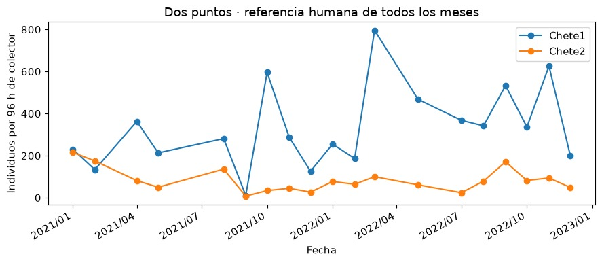
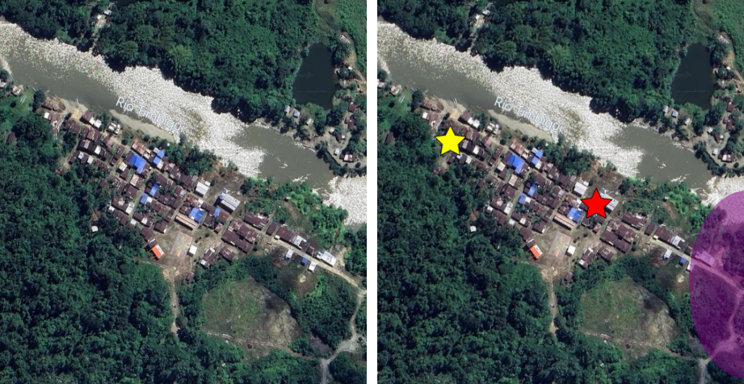

# Plan de análisis

Juan Montoya y Laura Ostos

## Hoja de campo de mosquitos

**Hoja de Campo:** Recolección de Datos Experimentales  
Fecha: \_\_\_\_\_\_\_\_\_\_\_\_\_\_\_\_  
Recolectores:   
\_\_\_\_\_\_\_\_\_\_\_\_\_\_\_\_\_\_\_\_\_\_\_\_\_\_\_\_\_\_\_\_\_\_\_\_\_\_\_\_\_\_\_\_\_  
\_\_\_\_\_\_\_\_\_\_\_\_\_\_\_\_\_\_\_\_\_\_\_\_\_\_\_\_\_\_\_\_\_\_\_\_\_\_\_\_\_\_\_\_\_

La hoja corresponde a nuestra propuesta de cuatro recipientes pasivos durante 8–10 horas por noche; las casillas vacías no son observaciones. Los frascos 1 y 2 son oscuros; 3 y 4, claros. En observaciones anotaremos el punto, las horas de instalación y retiro, las horas efectivas, la hora de lectura del CO₂, los *Anopheles* confirmados y cualquier fallo. Un cero indica que el recipiente funcionó sin capturas; un dato faltante o un fallo se deja señalado.

**Noche 1: En población**

| Frascos | Ubicación |  | Dióxido de carbono (CO2 en ppm)  | Ácido Láctico (si/no) | Total mosquitos por frasco |
| ----- | :---: | :---: | :---: | :---: | :---: |
|  | **Interior** | **Exterior** |  |  |  |
| **1 (oscuro)** |  |  |  |  |  |
| **2 (oscuro)** |  |  |  |  |  |
| **3** |  |  |  |  |  |
| **4** |  |  |  |  |  |
| **Total de mosquitos** |  |  |  |  |  |

**Observaciones: \_\_\_\_\_\_\_\_\_\_\_\_\_\_\_\_\_\_\_\_\_\_\_\_\_\_\_\_\_\_\_\_\_\_\_\_\_\_\_\_\_\_\_\_\_\_\_\_\_\_\_\_\_\_\_\_\_\_\_**  
**\_\_\_\_\_\_\_\_\_\_\_\_\_\_\_\_\_\_\_\_\_\_\_\_\_\_\_\_\_\_\_\_\_\_\_\_\_\_\_\_\_\_\_\_\_\_\_\_\_\_\_\_\_\_\_\_\_\_\_\_\_\_\_\_\_\_\_\_\_\_\_\_\_\_\_\_\_\_\_\_\_\_\_\_\_\_\_\_\_\_\_\_\_\_\_\_\_\_\_\_\_\_\_\_\_\_\_\_\_\_\_\_\_\_\_\_\_\_\_\_\_\_\_\_\_\_\_\_\_\_\_\_\_\_\_\_\_\_\_\_\_\_\_\_\_\_\_\_\_\_\_\_\_\_\_\_\_\_\_\_\_\_\_\_\_\_\_\_\_\_\_\_\_\_\_\_\_\_\_\_\_\_\_\_\_\_\_\_\_\_\_\_\_\_\_\_\_\_\_\_\_\_\_\_\_\_\_\_\_\_\_\_\_\_\_\_\_\_\_**

**Noche 2: En población**

| Frascos | Ubicación |  | Dióxido de carbono (CO2 en ppm)  | Ácido Láctico (si/no) | Total mosquitos por frasco |
| ----- | :---: | :---: | :---: | :---: | :---: |
|  | **Interior** | **Exterior** |  |  |  |
| **1 (oscuro)** |  |  |  |  |  |
| **2 (oscuro)** |  |  |  |  |  |
| **3** |  |  |  |  |  |
| **4** |  |  |  |  |  |
| **Total de mosquitos** |  |  |  |  |  |

**Observaciones: \_\_\_\_\_\_\_\_\_\_\_\_\_\_\_\_\_\_\_\_\_\_\_\_\_\_\_\_\_\_\_\_\_\_\_\_\_\_\_\_\_\_\_\_\_\_\_\_\_\_\_\_\_\_\_\_\_\_\_**  
**\_\_\_\_\_\_\_\_\_\_\_\_\_\_\_\_\_\_\_\_\_\_\_\_\_\_\_\_\_\_\_\_\_\_\_\_\_\_\_\_\_\_\_\_\_\_\_\_\_\_\_\_\_\_\_\_\_\_\_\_\_\_\_\_\_\_\_\_\_\_\_\_\_\_\_\_\_\_\_\_\_\_\_\_\_\_\_\_\_\_\_\_\_\_\_\_\_\_\_\_\_\_\_\_\_\_\_\_\_\_\_\_\_\_\_\_\_\_\_\_\_\_\_\_\_\_\_\_\_\_\_\_\_\_\_\_\_\_\_\_\_\_\_\_\_\_\_\_\_\_\_\_\_\_\_\_\_\_\_\_\_\_\_\_\_\_\_\_\_\_\_\_\_\_\_\_\_\_\_\_\_\_\_\_\_\_\_\_\_\_\_\_\_\_\_\_\_\_\_\_\_\_\_\_\_\_\_\_\_\_\_\_\_\_\_\_\_\_\_**

**Noche 3: Cerca a la Mina**

| Frascos | Ubicación |  | Dióxido de carbono (CO2 en ppm)  | Ácido Láctico (si/no) | Total mosquitos por frasco |
| ----- | :---: | :---: | :---: | :---: | :---: |
|  | **Interior** | **Exterior** |  |  |  |
| **1 (oscuro)** |  |  |  |  |  |
| **2 (oscuro)** |  |  |  |  |  |
| **3** |  |  |  |  |  |
| **4** |  |  |  |  |  |
| **Total de mosquitos** |  |  |  |  |  |

**Observaciones: \_\_\_\_\_\_\_\_\_\_\_\_\_\_\_\_\_\_\_\_\_\_\_\_\_\_\_\_\_\_\_\_\_\_\_\_\_\_\_\_\_\_\_\_\_\_\_\_\_\_\_\_\_\_\_\_\_\_\_**  
**\_\_\_\_\_\_\_\_\_\_\_\_\_\_\_\_\_\_\_\_\_\_\_\_\_\_\_\_\_\_\_\_\_\_\_\_\_\_\_\_\_\_\_\_\_\_\_\_\_\_\_\_\_\_\_\_\_\_\_\_\_\_\_\_\_\_\_\_\_\_\_\_\_\_\_\_\_\_\_\_\_\_\_\_\_\_\_\_\_\_\_\_\_\_\_\_\_\_\_\_\_\_\_\_\_\_\_\_\_\_\_\_\_\_\_\_\_\_\_\_\_\_\_\_\_\_\_\_\_\_\_\_\_\_\_\_\_\_\_\_\_\_\_\_\_\_\_\_\_\_\_\_\_\_\_\_\_\_\_\_\_\_\_\_\_\_\_\_\_\_\_\_\_\_\_\_\_\_\_\_\_\_\_\_\_\_\_\_\_\_\_\_\_\_\_\_\_\_\_\_\_\_\_\_\_\_\_\_\_\_\_\_\_\_\_\_\_\_\_**

**Noche 4: Cerca a la Mina**

| Frascos | Ubicación |  | Dióxido de carbono (CO2 en ppm)  | Ácido Láctico (si/no) | Total mosquitos por frasco |
| ----- | :---: | :---: | :---: | :---: | :---: |
|  | **Interior** | **Exterior** |  |  |  |
| **1 (oscuro)** |  |  |  |  |  |
| **2 (oscuro)** |  |  |  |  |  |
| **3** |  |  |  |  |  |
| **4** |  |  |  |  |  |
| **Total de mosquitos** |  |  |  |  |  |

**Observaciones: \_\_\_\_\_\_\_\_\_\_\_\_\_\_\_\_\_\_\_\_\_\_\_\_\_\_\_\_\_\_\_\_\_\_\_\_\_\_\_\_\_\_\_\_\_\_\_\_\_\_\_\_\_\_\_\_\_\_\_**  
**\_\_\_\_\_\_\_\_\_\_\_\_\_\_\_\_\_\_\_\_\_\_\_\_\_\_\_\_\_\_\_\_\_\_\_\_\_\_\_\_\_\_\_\_\_\_\_\_\_\_\_\_\_\_\_\_\_\_\_\_\_\_\_\_\_\_\_\_\_\_\_\_\_\_\_\_\_\_\_\_\_\_\_\_\_\_\_\_\_\_\_\_\_\_\_\_\_\_\_\_\_\_\_\_\_\_\_\_\_\_\_\_\_\_\_\_\_\_\_\_\_\_\_\_\_\_\_\_\_\_\_\_\_\_\_\_\_\_\_\_\_\_\_\_\_\_\_\_\_\_\_\_\_\_\_\_\_\_\_\_\_\_\_\_\_\_\_\_\_\_\_\_\_\_\_\_\_\_\_\_\_\_\_\_\_\_\_\_\_\_\_\_\_\_\_\_\_\_\_\_\_\_\_\_\_\_\_\_\_\_\_\_\_\_\_\_\_\_\_**

**¿Qué registró el estudio que ustedes no habían pensado, y qué echan de menos?**

Revisando los registros de dos años compartidos por el equipo de entomología encontramos la identificación de especie, sexo y muestra, que no habíamos incluido en nuestra hoja. La descripción del estudio menciona *An. nuneztovari* C en el contexto de Colombia, pero las capturas del ZIP corresponden a *An. neivai*, *An. albimanus* y *An. apicimacula*. Los 1502 registros publicados indican «Hembra»; esto no permite comparar sexos ni conocer si los individuos estaban infectados [1].

**¿Qué supuestos no se pueden comparar con la base de datos?**

Los supuestos que no se podrían comparar son: cercanía a aguas estancadas o a una mina, presencia de dióxido de carbono, presencia de ácido láctico, contraste de colores y exterior/interior. Tampoco hay mediciones de lluvia por evento para comprobar la temporada lluviosa.

**¿Qué supuestos sobreviven?**

Podemos seleccionar el género *Anopheles*, Cheté y noviembre, distinguir los dos puntos publicados y sumar individuos. Podemos comparar tasas normalizadas por esfuerzo y convertirlas a cuatro noches del protocolo del estudio. Los eventos agrupan varias noches: no conocemos el conteo de cada noche ni podemos confirmar la lluvia a partir del mes.

La gráfica muestra variación entre visitas de Chete1 y Chete2. El eje vertical expresa individuos equivalentes a 96 horas de colector, no los conteos brutos. Los picos no demuestran un máximo repetido en septiembre ni confirman el supuesto de temporada lluviosa; para esto último faltan registros locales de precipitación.

En la figura anterior (izquierda: mapa de Cheté; derecha: puntos de recolección), la estrella roja identifica Chete1 y la amarilla, Chete2, separados por aproximadamente 230 metros. El sombreado morado señala el sector que el equipo identifica como más cercano a una zona de minería ilegal. La imagen aporta contexto visual; el ZIP no mide distancia ni exposición minera y no permite clasificar los puntos como «población» y «mina».

**Preguntas a los datos**

* Si con los supuestos que sobrevivieron ¿Se puede estimar la cantidad de mosquitos de los supuestos de la base datos?

**Tres Decisiones**

**1\. Observación:**   
En nuestra hoja, un recipiente durante una noche. En los datos publicados, una visita de una localidad en un mes de campaña, agrupando sus puntos y especies.

**2\. Predicción:**  
Se quiere predecir la cantidad de mosquitos capturados en cuatro noches en Cheté con el protocolo del estudio, equivalentes a 96 horas de colector. La conversión a nuestros recipientes pasivos depende de un rendimiento relativo que estos datos no miden.

**3\. Funcionamiento:**   
Comparar el error absoluto medio de las predicciones en las mismas visitas posteriores con la tasa histórica y la última visita de Cheté. Las comparaciones descriptivas entre lugares y meses se normalizan por esfuerzo y se presentan por separado.

**Ámbitos de comparación**

* Comparar el subconjunto compatible con nuestra hoja con el total de la base de datos, tomando todas las regiones y meses.
* Comparar Cheté en noviembre mediante tasas normalizadas al esfuerzo equivalente de cuatro noches del estudio.

Estos dos ámbitos no son la reserva de evaluación. La reserva temporal reúne las visitas 20, 21 y 22 de Cheté, de enero a marzo de 2023, con ambos puntos juntos; sus seis eventos se enumeran en «Reserva antes de explorar».

Para construir el segundo ámbito nos planteamos las siguientes preguntas:

1. ¿Qué datos pertenecen de la región de Cheté?  
2. De lo anterior ¿Qué datos son del mes de Noviembre?  
3. ¿Se pueden elegir aleatoriamente cuatro días de este mes o se debe normalizar por el tiempo de exposición? El ZIP agrupa varias noches por evento, por lo que no permite extraer cuatro conteos diarios; comparamos tasas por esfuerzo.

**Modelo Predictivo a seguir**

Un Random Forest para predecir la tasa de captura y convertirla a una cantidad por cuatro noches. La importancia por permutación mide cuánto cambia el error al mezclar las variables disponibles; no mide causalidad ni permite evaluar factores de nuestra hoja que no están registrados.

**Referencias**

**[1]** Ahumada ML, Vargas-García N, Ballesteros J, Díaz-Herrera T, Cotazo K, Vargas E, Alvarez-Fernández N, Moreno C, Calderón N, Aguirre J, Lucumí D, Vargas E, Levine R, Lenhart A, Morales CA, Herrera-Varela M. (2021). Especies del género Anopheles (Diptera: Culicidae) asociadas al domicilio humano en 25 localidades de los municipios de Timbiquí, Guapi y Santa Bárbara ubicadas un área endémica para malaria al suroccidente de Colombia. v1.0. Instituto Nacional de Salud. Dataset/Occurrence. https://doi.org/10.15472/kftrcn

[image1]: <>

## De dónde partimos

Queremos saber cuántos Anopheles podríamos recoger en cuatro noches de noviembre en Cheté. Nuestra idea fue dejar cuatro recipientes preparados durante 8 a 10 horas por noche, mientras las personas duermen, dos noches en población y dos cerca de una mina. Son colectores pasivos, sin vigilancia continua. Pensamos en el color del recipiente, la ubicación, el dióxido de carbono y añadir o no ácido láctico a un mismo señuelo.

La estimación que entregamos fue 3000 ± 800 mosquitos. El producto de los supuestos escritos, 4 noches por 4 recipientes por 200 ± 50 mosquitos por noche, da 3200 ± 800. El primer valor es nuestro redondeo inicial. Ese margen expresa escenarios que imaginamos, no un intervalo estadístico. Conservamos las cifras iniciales y documentamos la aclaración de duración y funcionamiento pasivo.

Los datos de preparación se anotan antes de dormir y el conteo se hace después de retirar los recipientes. La lectura de CO2 lleva la hora de medición; un registro continuo dependería de que el sensor lo guardara automáticamente. La propuesta no necesita mantener a alguien despierto junto a las trampas.

Este plan se escribe después de leer el reto, nuestra hoja, la descripción pública del estudio y las columnas y fechas del archivo. Todavía no hemos explorado los conteos de las campañas. La descripción pública ya muestra un total general; por eso no afirmamos que desconocíamos toda la información del estudio.

## Las tres decisiones principales

Una fila del archivo no es un mosquito ni necesariamente una noche. Primero verificaremos qué agrupa. Nuestra observación de análisis será una visita completa a Cheté, juntando sus puntos de captura y especies. Mantendremos juntas las filas de cada visita.

Queremos obtener una referencia con el método del estudio: cuatro noches con dos personas recolectoras activas simultáneas, una dentro y otra fuera, durante doce horas por noche. Esa captura manual con atrayente humano protegido difiere de dejar nuestros recipientes funcionando durante 8 a 10 horas de sueño. Usaremos la referencia para comparar, sin confundir horas de recipiente con horas de trabajo de un colector humano.

Mediremos el error absoluto medio en mosquitos por cuatro noches. Para considerar útil un modelo pediremos que mejore la referencia sencilla y la estimación revisada en la prueba final. Como criterio práctico inicial proponemos un error medio de hasta 200 mosquitos por noche, o 800 en cuatro noches, el margen de nuestra estimación original. También miraremos si un intervalo nominal del 80 % cubre los valores observados y qué tan ancho resulta. Con tres visitas de prueba esta comprobación será limitada.

## Qué datos usaremos

El archivo original es la versión 1.0 publicada por el Instituto Nacional de Salud, disponible en GBIF y en el SiB Colombia, con DOI 10.15472/kftrcn. El enlace corresponde a una publicación de datos con descripción del estudio. No lo trataremos como si hubiéramos leído un artículo distinto.

El análisis y el modelo se concentrarán en Cheté. Esto evita mezclar localidades con condiciones diferentes, aunque deja pocas visitas. Timbiquí completo serviría para un análisis posterior con más información y diferencias entre sitios. Todo el estudio mezcla además municipios y distribuciones de especies; su promedio general solo nos servirá como contexto publicado.

## Reserva antes de explorar

Reservamos completas las visitas 20, 21 y 22 de Cheté, correspondientes a enero, febrero y marzo de 2023. Sus identificadores son Chete1 y Chete2, seguidos por el número de visita. Los eventos son `Chete1-20` y `Chete2-20` (enero), `Chete1-21` y `Chete2-21` (febrero), y `Chete1-22` y `Chete2-22` (marzo); la misma lista está en el notebook.

Trabajaremos con las visitas 1 a 19 para la limpieza, las figuras, las preguntas y la elección del modelo. La reserva se reconoce por identificador, además de por calendario, para que una fecha incompleta no termine enviando una fila al entrenamiento.

Las capturas de la reserva se abrirán después de fijar las reglas de limpieza, las variables, el modelo, sus parámetros y el cálculo de incertidumbre. No se usarán para escoger otro modelo. Las divisiones internas también serán temporales: entrenaremos con las primeras siete visitas, validaremos en las tres siguientes y avanzaremos de tres en tres. Los dos puntos y todas las especies de una visita siempre viajarán juntos.

## Qué revisaremos antes de sumar

Revisaremos identificadores, repeticiones, fechas, conteos enteros no negativos, especies, sitio de captura y esfuerzo. Un intervalo entre fechas no significa que hayan capturado durante todos esos días. Usaremos las horas y noches declaradas en el esfuerzo, después de comprobar cómo se repiten entre especies y ambientes.

No sumaremos varias veces un mismo esfuerzo porque aparezcan varias especies. Si no podemos recuperar con certeza las noches efectivas, declararemos el supuesto usado y repetiremos la comparación con otra lectura razonable. Un campo vacío o una combinación ausente no se convertirá automáticamente en cero.

Las fechas faltantes solo se completarán cuando otras filas del mismo evento permitan hacerlo sin ambigüedad. Un error de calendario se dejará visible y no se corregirá por conveniencia del resultado. No eliminaremos una captura alta solamente por ser alta.

## Las preguntas que guían el trabajo

¿Qué cambia al comparar nuestra hoja con la forma de captura del estudio? Revisaremos método, duración, especies, ambientes, identificación de muestras y variables que faltan.

¿Nuestra cifra inicial tiene un orden de magnitud razonable? Compararemos tasas con unidades claras. Distinguiremos cuatro recipientes de cuatro noches con dos colectores. La cantidad de huevos por hembra no se tomará como una tasa de captura de adultos.

Nuestra pregunta inicial era: ¿se capturan más mosquitos fuera o dentro de las viviendas de Cheté? Proponíamos comparar ambos ambientes dentro de las mismas visitas, con el esfuerzo correspondiente. La revisión de las variables obligó a cambiarla por la comparación de puntos que se explica al final. El hallazgo se pondrá a prueba cambiando la medida de resumen y revisando la influencia de las primeras visitas.

Como pregunta propia, ¿el mosquito más abundante en Cheté es el mismo que domina en el resumen general del estudio, y se mantiene ese patrón entre visitas? Compararemos la composición por especie y su variación sin confundir abundancia con infección o riesgo de enfermedad.

## Cómo mediremos la incertidumbre

Para una estimación descriptiva usaremos remuestreo de bloques de visitas consecutivas, manteniendo juntos los puntos y especies de cada visita. Así no trataremos cada mosquito o cada fila como una repetición independiente. Compararemos bloques de dos y tres visitas para ver cuánto cambia el resultado.

La incertidumbre de una captura futura será distinta de la incertidumbre del promedio. La estimaremos con los errores de predicción obtenidos al validar hacia adelante, antes de abrir la reserva. Su cobertura será aproximada: hay pocas visitas y las condiciones pueden cambiar.

## Modelo y referencias

Usaremos una regresión de conteo sencilla con la fecha prevista como información disponible antes de viajar. Representaremos la época del año mediante seno y coseno del mes y añadiremos el tiempo transcurrido. El esfuerzo conocido permitirá pasar de tasa a total. Probaremos una pequeña lista de regularizaciones y escogeremos por el error temporal.

La primera referencia será mantener la tasa de la última visita disponible. Nuestra estimación revisada será multiplicar la tasa histórica de captura, calculada solo con el entrenamiento, por el esfuerzo de cuatro noches. La estimación original de 3000 quedará como comparación de contexto, porque procede de otro método.

No usaremos la especie finalmente capturada, el conteo de otra fila de la misma visita ni mediciones conocidas solo después de salir como entradas del modelo. Para evaluar enero a marzo pronosticaremos el bloque completo desde diciembre de 2022, sin actualizarlo con capturas de la reserva.

## Qué no podremos resolver

Los datos no incluyen nuestro color de recipiente, el añadido de ácido láctico ni mediciones de dióxido de carbono. Tampoco identifican una comparación entre mina y población. Esas ideas siguen siendo hipótesis para un experimento propio.

Capturar primero en población y luego en mina confunde el lugar con la noche. Para estudiar esa diferencia habría que observar ambos lugares en las mismas noches, con esfuerzo comparable y asignación equilibrada de recipientes y señuelos.

Comprobaremos si hay lluvia medida. Si no la hay, no llamaremos lluviosa a una visita solo por el mes. Harían falta registros locales de precipitación y su relación temporal con cada captura. La medición adicional que priorizamos es la lluvia acumulada antes y durante cada visita, manteniendo también un registro claro del esfuerzo.

El conjunto trata de Anopheles y malaria. No permite concluir sobre dengue, chikungunya, huevos por hembra, infección de los mosquitos o efectividad causal de una intervención si esas variables no están publicadas.

## Cambios durante el trabajo

Después de revisar únicamente las visitas de desarrollo encontramos que el protocolo distingue interior y exterior, pero el archivo publicado no conserva esa separación. El campo de hábitat solo dice «En domicilio». Por eso sustituimos esa comparación por las tasas de los puntos Chete1 y Chete2 dentro de cada visita. Estos nombres no significan interior y exterior, ni población y mina.

Una fila agrupa una especie y un evento. Sumaremos los individuos publicados por evento, tomaremos el máximo de noches declarado entre sus especies y mantendremos las horas de captura. Este máximo es una aproximación al esfuerzo del evento, no una reconstrucción garantizada de todas las noches sin capturas. En enero de 2021 el esfuerzo varía entre especies; comprobaremos el resultado excluyendo las dos visitas iniciales de catorce horas.

La observación final será la visita, con ambos puntos juntos. Para calcular el esfuerzo multiplicamos horas por noche, noches declaradas y dos colectores en cada punto; luego sumamos los esfuerzos de ambos puntos. La tasa es el total de individuos dividido por ese esfuerzo. Al multiplicarla por 96 horas de colector obtenemos el equivalente de cuatro noches de doce horas con dos colectores en total. Cuatro noches en cada punto con dos parejas simultáneas serían 192 horas de colector, otro escenario. La mezcla de puntos se aproxima mediante la distribución histórica del esfuerzo.

El hallazgo principal será la diferencia de tasas entre puntos. Lo contrastaremos con un intervalo de remuestreo por bloques, con la mediana de las diferencias, excluyendo la línea base y quitando una visita cada vez. Conservaremos todas las capturas altas en el análisis principal.

La incertidumbre de predicción se calculará usando los primeros dos bloques de validación para elegir la regularización y los últimos dos para obtener el margen del intervalo. Así no elegimos el modelo y su margen con los mismos errores. Habrá seis visitas de calibración: el intervalo nominal del 80 % será orientativo, sin garantía de cobertura temporal. Usaremos el error absoluto ordenado en la posición superior correspondiente al 80 %, que con seis visitas resulta ser el mayor, y no una aproximación de Poisson que suponga varianza igual a la media.

Al abrir la reserva, después de cerrar el modelo, apareció una combinación repetida de evento y especie en Chete2 durante enero de 2023. La comprobación inicial suponía que esa combinación siempre era única y detuvo la ejecución. Los identificadores son distintos y los conteos son 65 y 2; no son filas idénticas. Se cambió esa comprobación por una marca de revisión y se conservaron ambas filas bajo la regla ya fijada de sumar individuos publicados. No se modificaron modelo, parámetros, margen ni pronósticos. Una fecha faltante se recuperó a partir del mismo evento, como estaba previsto.

En una revisión posterior a la evaluación añadimos una comprobación descriptiva de Fermi usando solo el desarrollo: ponderar por esfuerzo, dar el mismo peso a las visitas, excluir las dos primeras o repartir por igual las noches entre los dos puntos. También aclaramos el ejemplo de conversión a cuatro noches y la interpretación de las métricas. Esta revisión no se usó para volver a escoger el modelo ni se presenta como una nueva prueba ciega.

Después el equipo precisó que su propuesta contemplaba 8 a 10 horas de sueño y recipientes que funcionan sin vigilancia. Corregimos la descripción de ocho horas fijas y la lectura de la hoja de campo. Los 200 mosquitos centrales por recipiente y noche implican entre 20 y 25 por hora; las cuatro noches con cuatro recipientes suman entre 128 y 160 horas de recipiente. Esta aclaración no convierte ese tiempo en horas de colector humano ni cambia la evaluación ya cerrada del estudio.

### Noviembre, nuestros supuestos y los gráficos espaciales

El equipo recordó que las cuatro noches propuestas eran de noviembre y pidió que la comparación empezara por sus supuestos, dejando el conjunto regional para el final. El filtro principal pasó a ser Cheté, género Anopheles y mes 11. Se muestran las siete filas que cumplen el filtro, sus cuatro eventos y las visitas 8 y 18, correspondientes a noviembre de 2021 y 2022. Ambas pertenecen al desarrollo.

La tasa medida es 1197 individuos divididos por 432 horas de colector. La cuenta propia es esa tasa por q, por cuatro recipientes, por cuatro noches y por 8 o 10 horas. q representa el rendimiento horario de un recipiente relativo al de un colector humano. El ZIP no lo mide; q=1 produce un escenario de 355 a 443 individuos. El cambio de horas supone tasa uniforme durante la noche, porque el archivo no tiene desglose horario. No se filtra como si Chete1 fuera población y Chete2 mina.

Mostramos cada noviembre por separado: con q=1, el de 2021 da 254–318 y el de 2022 da 480–600. Es variación entre dos temporadas y entre duraciones, no un intervalo de confianza. Para alcanzar los 3000 iniciales haría falta q entre 6.8 y 8.5. Esta comparación revisa el supuesto de rendimiento sin afirmar que se observaron nuestras trampas.

En esa revisión se hizo un pair plot de diez variables disponibles o derivadas, con los 38 eventos de desarrollo. Tras revisarlo, el equipo prefirió histogramas para las distribuciones de conteos y tasas; ese cambio se recoge en el siguiente apartado.

El mapa de Cheté muestra las coordenadas WGS84 de los dos puntos y sus tasas de noviembre. Su separación aproximada es 227 m. No se publican coordenadas de una mina ni precisión del GPS. En el resumen regional la clave es municipio, localidad y evento, porque hay códigos de evento repetidos entre municipios. Los mapas de tasas y especies usan únicamente eventos con una posición válida; quedan fuera 40 eventos sin coordenadas y 17 con coordenadas contradictorias, pero se conservan en los totales generales. Se muestran 40 posiciones con el 92.8 % de los individuos del ZIP.

La comparación principal de noviembre y la referencia histórica del modelo son cuentas distintas. El modelo conserva su escala de 96 horas, sus variables, regularización, márgenes y reserva. Los gráficos nuevos y la ampliación regional son revisiones posteriores a la evaluación y no se presentan como decisiones previas. El resumen regional y la comparación con los supuestos del estudio aparecen al final del análisis.

### Comparar lugar y mes, y anticipar la cantidad con dos bosques

Juan y Laura aclararon que la historia principal es cuánto se parecen las cantidades del subconjunto compatible con nuestra hoja a las del estudio completo, después de igualar el esfuerzo. La hoja inicial planteaba sortear cuatro días en noviembre; verificamos que no se puede porque los eventos agrupan varias noches. Conservamos Cheté, noviembre y Anopheles como filtros y llevamos ambos rendimientos a 96 horas de colector. No elegimos un umbral de similitud. La cuenta es 266 frente a 310 individuos equivalentes, alrededor de 14 % menos en Cheté. El escenario pasivo de cuatro recipientes durante 8 a 10 horas sigue dependiendo del supuesto q.

Para escoger el alcance focal del Random Forest comparamos A (tasas por mes de Cheté) con B (tasas por localidad de Timbiquí en noviembre). Sumamos conteos y esfuerzo dentro de cada grupo. Calculamos el coeficiente de variación por año y damos el mismo peso a 2021 y 2022. A tiene 47,8 % en promedio y B 63,5 %; en 2021, por separado, B tiene menor variación. A sigue ganando en promedio al dejar solo jornadas de 12 horas o usar el rango intercuartílico dividido por la mediana. Esta elección se basa en el desarrollo, no en el MAE de enero a marzo. No cambia el filtro de noviembre en la comparación observada.

La observación para los bosques es una localidad en un mes de campaña. El bosque regional usa todo el pasado elegible y el focal A usa Cheté. Predicen la tasa, ponderan por el esfuerzo y reportan el equivalente en 96 horas. Usan solo lugar, calendario y última tasa que ya se conocería; el conteo, composición y esfuerzo futuros no son entradas. Reunimos 483 visitas regionales y 19 focales para el pronóstico de enero a marzo de 2023 con corte único antes del bloque. Los eventos sin fecha o con meses ambiguos no se pueden asignar al entrenamiento mensual, pero sí se conservan en los totales.

Hicimos diez ejercicios hacia adelante en 2022 para comparar MAE y calibrar un margen orientativo. Esa validación no es una prueba independiente de la regla A/B, que usa todo el desarrollo. En el bloque de tres visitas, el MAE regional es 52,80; el focal, 95,14; la tasa histórica, 64,04; y la última visita, 44,83. La tasa histórica tiene el menor error en los ejercicios de 2022. No recomendamos reemplazarla por un bosque sin mejora consistente. La importancia se mide permutando grupos de variables en validación; la localidad no varía en Cheté y se comprueba aparte para el bosque regional. La prueba de bosques es retrospectiva; no modifica el cierre anterior de Poisson.

Retiramos la matriz de pares y mostramos histogramas de conteos y tasas. Los mapas se apoyan en un recorte local de los cauces de OpenStreetMap, con atribución. La pregunta propia ahora compara otros lugares en los mismos noviembres: Cheté queda por debajo del resto del estudio y del resto de Timbiquí en ambos años. En 2022, en cambio, supera el promedio general que mezcla meses. Minería ilegal y restricciones de acceso quedan como preguntas futuras: el ZIP no registra esos factores ni los motivos del no muestreo.

### Intervalos, panel de noviembre y mapa

Volvemos a calcular el promedio por 96 horas de colector en 5000 muestras de bloques de visitas enteras. Las 19 visitas de desarrollo dan 210 individuos en promedio. El IC aproximado del 95 % es 177–247 con bloques de dos visitas y 173–246 con bloques de tres. Es para el promedio histórico de todos los meses; no es la incertidumbre de una nueva captura ni de solo noviembre.

La revisión calibra por separado el margen de predicción a uno, dos y tres meses de adelanto (10, 9 y 8 ejercicios comparables en 2022). La comparación usa las predicciones ya definidas y el mismo corte. Desde marzo, el escenario de noviembre de 2023 está a ocho meses de adelanto. Solo un ejercicio comparable a ese horizonte cae en noviembre, así que mostramos la estimación puntual sin trasladarle el margen de un mes.

En ambos años, la tasa de noviembre en Cheté superó la tasa conjunta de sus otros meses observados. En cambio, fue menor que la tasa conjunta del mismo panel de 24 localidades externas en ambos noviembres. El contraste se conserva si damos el mismo peso a los dos años. No lo presentamos como un efecto de la lluvia. La figura cartográfica tiene dos escalas, la silueta nacional y el detalle regional con la costa y los límites municipales del DANE (MGN 2023); las 40 coordenadas dibujadas coinciden con el municipio publicado.

### Imagen de contexto y revisión de entregables

El 19 de noviembre de 2026 se incorporó a la exposición la [imagen aportada por el equipo](../SintesisFinal_02/Datos/cete.png). En su leyenda, estrella roja = Chete1, estrella amarilla = Chete2 y sombreado morado = sector que el equipo identifica como más cercano a una zona de minería ilegal. Esta imagen complementa el mapa regional; no asigna una exposición a los eventos del ZIP, no entra en los bosques y no explica la diferencia entre los puntos.

Al revisar la hoja distinguimos los ámbitos de comparación de la reserva temporal, y el total recolectado de los *Anopheles* confirmados. La [Fermi anterior al análisis](../EstimacionFermi_00/estimacion_inicial.md) se conserva intacta. La comparación de los meses se refiere a la tasa conjunta de los otros meses, no a que noviembre supere a cada mes por separado.

### Fermi regional y calendario (revisión posterior)

El equipo propuso otra lectura de Fermi: 200 por recipiente y noche × 4 recipientes × 285 noches regionales = 228 000. Son 1394 menos que los 229 394 del resumen del INS (0,61 %). Verificamos por separado el total y las 1502 filas del ZIP. La cercanía en el total regional y el contraste local de 266 frente a 310 por 96 horas responden preguntas diferentes.

Para comprobar el orden de los meses, simulamos un único pronóstico de abril de 2022 a marzo de 2023 usando solo visitas terminadas antes del inicio. Congelamos la última tasa. Comparamos pares de meses con observaciones distintas al individuo: acertar vale 1 y empatar vale ½. En Cheté, el bosque focal obtiene 60,0 %, el regional 41,1 % y la tasa histórica 50,0 % (45 pares, diez meses). Para el promedio regional, comparando las mismas localidades dentro de cada par, el bosque obtiene 40,9 % en 55 pares. Las comparaciones comparten meses y el alcance focal se había elegido retrospectivamente; no es una confirmación independiente de una temporada.

Actualizamos una vez hasta marzo de 2023. En la región comparamos doce escenarios (abril de 2023–marzo de 2024) promediando las mismas **27 etiquetas municipio–localidad** con igual peso y 96 h en cada una. El resumen del INS declara 25 localidades; concretamente menciona 11 en Guapi, mientras la tabla trae 13 etiquetas allí. No fusionamos registros sin una equivalencia documentada. Al promediar solo las 25 etiquetas presentes en ambos noviembres (Cheté y 24 externas), el cambio máximo en los meses con datos fue de 13,2 individuos por 96 h. Junio, sin visitas, no recibe puesto; el primero cambia si exigimos dos años de respaldo.

En Cheté la referencia elegida por MAE es constante: los doce meses empatan en unos 200 individuos por cuatro noches del estudio. No trasladamos el orden regional a un punto ni los intervalos locales a la región. Noviembre sirve para repetir nuestra comparación, no como máximo comprobado.

### Qué podía ordenar el Random Forest

Queríamos saber qué factores de la hoja ayudaban a predecir. Al revisar los datos vimos el límite: la localidad publicada no equivale a interior/exterior ni a distancia a una mina; tampoco hay color, CO₂, señuelo o lluvia por evento. No se les puede asignar importancia. Para los predictores disponibles comparamos el aumento del MAE en las mismas visitas de validación de 2022: mezclamos calendario o última tasa entre meses de la misma localidad, y localidad entre sitios del mismo mes. La [sección 7.1 del notebook](../SintesisFinal_02/RetoMosquitos.ipynb#importancia-random-forest) presenta los valores por bosque y ámbito. Esta lectura posterior no cambió el ajuste ni usó la reserva de 2023.

## Uso de IA y entrega

La IA ayudó a organizar este plan a partir de nuestras ideas, a distinguir captura por noche de esfuerzo y a proponer una evaluación temporal. El código, las figuras y las cifras estarán en un único notebook que se pueda ejecutar completo con el archivo original. La síntesis del plan y la presentación serán documentos breves de apoyo.

La publicación en GitHub deja la fecha comprobable del plan. Este archivo local por sí solo no demuestra una entrega anterior. Antes de la sustentación cada integrante deberá revisar el notebook y escribir su reflexión personal con sus propias palabras.
