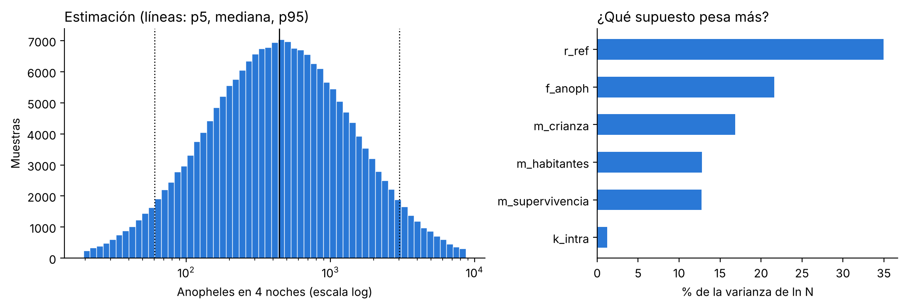

# Punto 1: Antes de empacar

Mateo Caballero Serna, Lucian Valle Aguilar

**Pregunta:** ¿cuántos mosquitos traeremos después de cuatro noches en Cheté? Estimación hecha antes de ver los datos. Las cifras salen de `estimacion_fermi.ipynb`.

## Hipótesis

Cheté es un pueblo rural pequeño junto al río Timbiquí, con zonas verdes, agua cerca, lluvias frecuentes y 25–30 °C. La captura usa personas como cebo, así que casi todo lo capturado son hembras (los machos se alimentan de néctar).

No estimamos la población del pueblo, porque no se puede medir. Partimos de cuántos zancudos se le posan a una persona por hora ($r_{ref}$) y lo ajustamos con tres factores: $m_{crianza}$ (humedad, río, lluvias), $m_{supervivencia}$ (temperatura, depredadores, fumigación) y $m_{habitantes}$ (personas y animales que sirven de alimento).

**Cómo organizaríamos la captura:** 4 noches, de 6:00 pm a 6:00 am (12 h, en dos turnos), en 3 casas, con un colector adentro y otro afuera de cada una. Eso da **288 persona-horas**. Se guarda todo lo que se posa y en el laboratorio se separa por género.

$$N_{total} = 4 \times 12 \times 3 \times (1 + k_{intra}) \times r_{ref}\, m_{crianza}\, m_{supervivencia}\, m_{habitantes}, \qquad N_{Anoph} = N_{total} \times f_{Anoph}$$

## Valores escogidos (percentiles 5 y 95)

- $r_{ref}$ = [1, 10]: zona rural de tierra caliente sin repelente; varios zancudos por hora al anochecer, menos el resto de la noche.
- $m_{crianza}$ = [1, 5]: con el río y la lluvia es difícil tener menos criaderos que la referencia.
- $m_{supervivencia}$ = [0.5, 2]: temperatura cercana al óptimo (~25 °C, Mordecai et al., 2013), pero no sabemos de fumigación ni depredadores.
- $m_{habitantes}$ = [0.5, 2]: no sabemos si más gente atrae más mosquitos o los reparte.
- $f_{Anoph}$ = [0.1, 0.6]: al cebo también llegan *Culex*, *Mansonia* y otros.
- $k_{intra}$ = [0.3, 1]: adentro se captura igual o menos que afuera.

## Resultado

Con un Monte Carlo de 200 000 muestras:

- **Anopheles: mediana de 442, rango de 90 % entre 61 y 3 014.**
- Total capturado: mediana de 1 597, entre 284 y 9 026.
- Frascos (si caben 50 por frasco): 32 para la mediana y 181 para el valor alto. Planeamos con el valor alto, porque en campo no se consiguen frascos.

## Supuesto que más pesa

**$r_{ref}$** explica el 35 % de la varianza, seguido de $f_{Anoph}$ (22 %) y $m_{crianza}$ (17 %). Es lo primero que comprobaríamos en campo: capturas de la primera noche divididas entre las persona-horas. Con datos solo se puede comprobar el producto de los factores, no cada uno.

**Limitaciones:** casas y noches iguales; factores independientes.

Referencias: Mordecai et al. (2013), *Ecology Letters* 16:22–30. Service (2012), *Medical Entomology for Students*.
